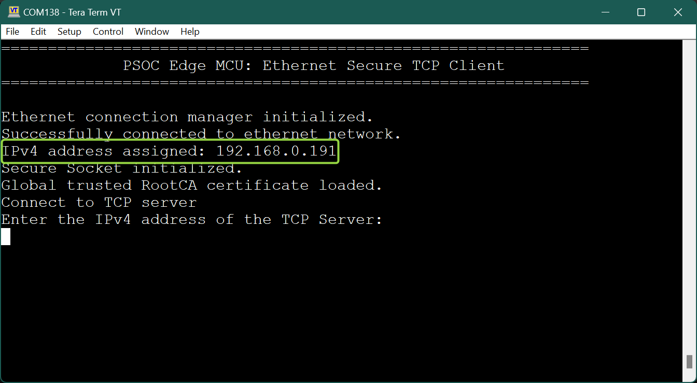
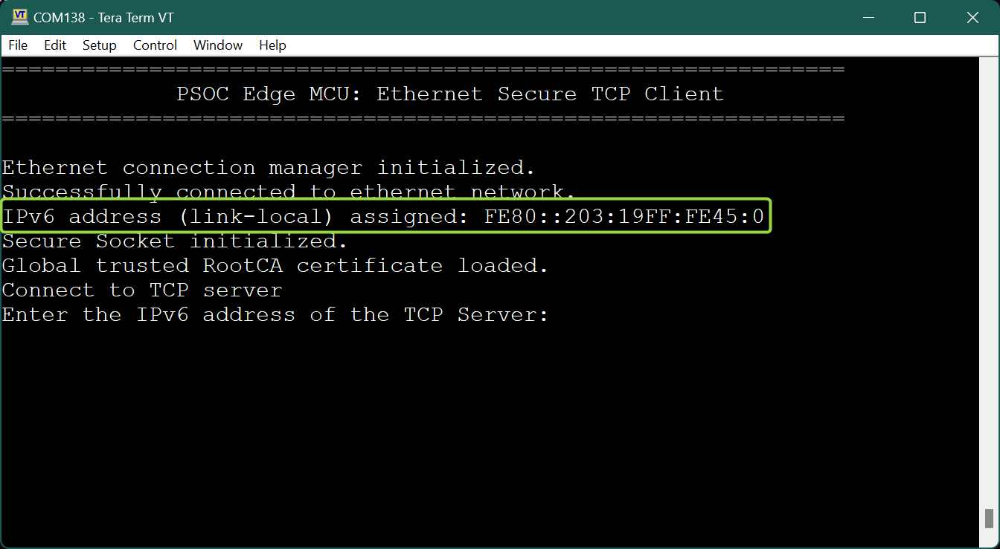
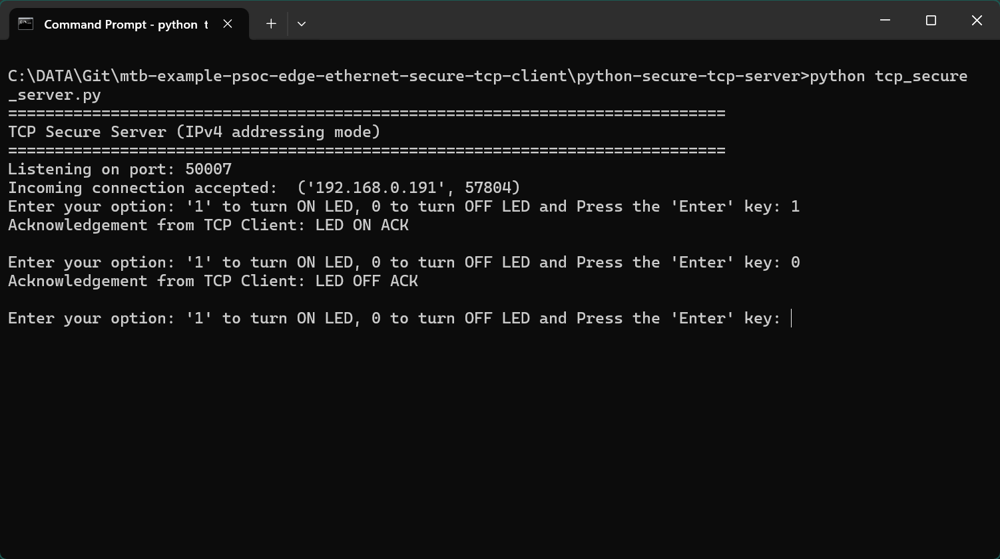
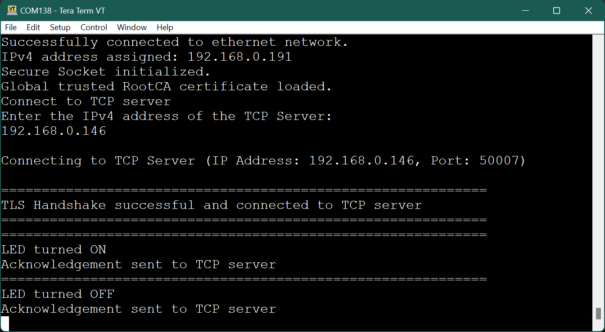
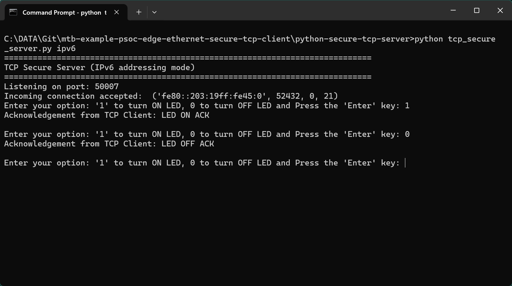
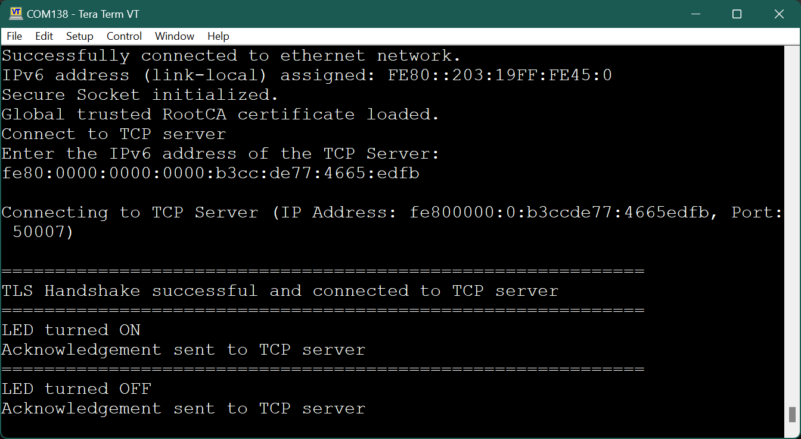

# PSOC&trade; Edge MCU: Ethernet secure TCP client

This code example demonstrates the implementation of a secure TCP client with PSOC&trade; Edge E84 MCU.

In this example, the TCP client establishes a secure connection with a TCP server through an SSL handshake. After the SSL handshake completes successfully, the TCP client turns the user LED ON/OFF based on the command received from the TCP server.

This example uses the Ethernet Core FreeRTOS LwIP Mbed TLS library of the software development kit (SDK). This library enables application development based on Ethernet by bundling together various other libraries: Ethernet connection manager, FreeRTOS, lwIP TCP/IP stack, Mbed TLS, and secure sockets. The secure sockets library provides an easy-to-use API by abstracting the network stack (LwIP) and the security stack (Mbed TLS).

This code example has a three project structure: CM33 secure, CM33 non-secure, and CM55 projects. All three projects are programmed to the external QSPI flash and executed in Execute in Place (XIP) mode. Extended boot launches the CM33 secure project from a fixed location in the external flash, which then configures the protection settings and launches the CM33 non-secure application. Additionally, CM33 non-secure application enables CM55 CPU and launches the CM55 application.


[View this README on GitHub.](https://github.com/Infineon/mtb-example-psoc-edge-ethernet-secure-tcp-client)

[Provide feedback on this code example.](https://yourvoice.infineon.com/jfe/form/SV_1NTns53sK2yiljn?Q_EED=eyJVbmlxdWUgRG9jIElkIjoiQ0UyNDE5MDEiLCJTcGVjIE51bWJlciI6IjAwMi00MTkwMSIsIkRvYyBUaXRsZSI6IlBTT0MmdHJhZGU7IEVkZ2UgTUNVOiBFdGhlcm5ldCBzZWN1cmUgVENQIGNsaWVudCIsInJpZCI6InNyaWthbnRoLmRzQGluZmluZW9uLmNvbSIsIkRvYyB2ZXJzaW9uIjoiMS4xLjAiLCJEb2MgTGFuZ3VhZ2UiOiJFbmdsaXNoIiwiRG9jIERpdmlzaW9uIjoiTUNEIiwiRG9jIEJVIjoiSUNXIiwiRG9jIEZhbWlseSI6IlBTT0MifQ==)

See the [Design and implementation](docs/design_and_implementation.md) for the functional description of this code example.


## Requirements

- [ModusToolbox&trade;](https://www.infineon.com/modustoolbox) v3.7 or later (tested with v3.7)
- Board support package (BSP) minimum required version: 1.0.0
- Programming language: C
- Associated parts: All [PSOC&trade; Edge E84 MCU](https://www.infineon.com/products/microcontroller/32-bit-psoc-arm-cortex/32-bit-psoc-edge-arm/psoc-edge-e84) parts


## Supported toolchains (make variable 'TOOLCHAIN')

- GNU Arm&reg; Embedded Compiler v14.2.1 (`GCC_ARM`) – Default value of `TOOLCHAIN`
- Arm&reg; Compiler v6.22 (`ARM`)
- IAR C/C++ Compiler v9.50.2 (`IAR`)
- LLVM Embedded Toolchain for Arm&reg; v19.1.5 (`LLVM_ARM`)


## Supported kits (make variable 'TARGET')

- [PSOC&trade; Edge E84 Evaluation Kit](https://www.infineon.com/KIT_PSE84_EVAL) (`KIT_PSE84_EVAL_EPC2`) – Default value of `TARGET`


## Hardware setup

This example requires the board rework. See the "Rework for Ethernet subsystem" section in the kit user guide to configure the board correctly. This example is configured to work in **MII** PHY interconnect mode by default.

Ensure the following jumper and pin configuration on board:
- BOOT SW must be in the HIGH/ON position
- J20 and J21 must be in the tristate/not connected (NC) position

> **Note:** On the PSOC&trade; Edge E84 Evaluation Kit, a few of the Ethernet pins are multiplexed with the Bluetooth&reg; UART pins of the radio module. Therefore, after the board rework, the Bluetooth&reg; functionality cannot be concurrently used with the along with Ethernet.


## Software setup

See the [ModusToolbox&trade; tools package installation guide](https://www.infineon.com/ModusToolboxInstallguide) for information about installing and configuring the tools package.

Install a terminal emulator if you do not have one. Instructions in this document use [Tera Term](https://teratermproject.github.io/index-en.html).

Install the python interpreter and add it to the top of the system path in environmental variables. This code example is tested with [Python 3.12.4](https://www.python.org/downloads/release/python-3124/).


## Operation

See [Using the code example](docs/using_the_code_example.md) for instructions on creating a project, opening it in various supported IDEs, and performing tasks, such as building, programming, and debugging the application within the respective IDEs.

1. Connect the board to your PC using the provided USB cable through the KitProg3 USB connector

2. Connect one LAN cable from the target board (client) to the router and another LAN cable from your PC (server) to the router

3. Open a terminal program and select the KitProg3 COM port. Set the serial port parameters to 8N1 and 115200 baud

4. After programming, the application starts automatically. Confirm that the text as shown in either one of the following figures is displayed on the UART terminal

   **Figure 1** shows the Ethernet connection status using IPv4 address  
   **Figure 1. UART terminal showing the Ethernet connection status (IPv4 addressing mode)**

     

   <br>

   **Figure 2** shows the Ethernet connection status using IPv6 address  
   **Figure 2. UART terminal showing the Ethernet connection status (IPv6 addressing mode)**

     

   <br>

5. Determine the computer's IP address

   To determine the IP address, type the following command in the command-shell based on your operating system:

   Windows: `ipconfig`

   Linux: `curl ifconfig.me`

   macOS: `ifconfig | grep inet`
   
6. Ensure that the python interpreter (see [Software setup](#software-setup)) is installed on your computer

7. Open a command-shell from the project directory and run the python TCP secure server (`{project directory}/python-secure-tcp-server`) by typing in the following command:

   **For IPv4-based addressing**

   ```
   python tcp_secure_server.py
   ```

   **For link-local IPv6-based addressing**

   ```
   python tcp_secure_server.py ipv6
   ```

   On Linux and macOS, check for the IPv4 address of an Ethernet connection in the network settings under system settings. For example, if the IPv4 address of the Linux or macOS is found to be 192.168.1.2, then replace the following line of code in the `_tcp_secure_server.py_` Python script with the IPv4 address as shown before running the script

   Replace
   ```
   host = ''       # Symbolic name meaning the local host
   ```
   with
   ```
   host = '192.168.1.2'       # Symbolic name meaning the local host
   ```

   > **Note:** Ensure that the firewall settings of your computer allow access to the python software so that it can communicate with the TCP client. For more details on enabling python access, see this [community thread](https://community.infineon.com/thread/53662)

8. In the terminal program, enter the IP address determined in **Step 7**

9. From the python secure TCP server, send the command to turn the LED ON or OFF to the TCP client ('0' to turn the USER_LED1 OFF and '1' to turn the LED ON). Observe the user LED turning ON/OFF on the board

   **Figure 3** shows the LED status on TCP server which is run using python script using IPv4 address  
   **Figure 3. LED status on TCP server (IPv4 addressing mode) - using python script**


     
   <br>

   **Figure 4** shows the LED status on TCP client using IPv4 address  
   **Figure 4. LED status on TCP client (IPv4 addressing mode)**

     

   <br>

   **Figure 5** shows the LED status on TCP server which is run using python script using IPv6 address  
   **Figure 5. LED status on TCP server (IPv6 addressing mode) using python script**

     

   <br>

   **Figure 6** shows LED status on TCP client using IPv6 address  
   **Figure 6. LED status on TCP client (IPv6 addressing mode)**

     

   <br>

> **Note:** Instead of using the python TCP server (*tcp_secure_server.py*), alternatively you can use the [mtb-example-psoc-edge-ethernet-secure-tcp-server](https://github.com/Infineon/mtb-example-psoc-edge-ethernet-secure-tcp-server) example to run as the TCP server on the second kit. See the code example documentation to learn how to use the example. If you are using it as the server, the IP address (`TCP_SERVER_IP_ADDRESS`) assigned in **Step 5** in the [Operation](#operation) section should be that of the IP address assigned to the second kit.


### Creating a self-signed SSL certificate

The TCP client demonstrated in this example uses a self-signed SSL certificate. This requires **OpenSSL**, which is already preloaded in ModusToolbox&trade;. Self-signed SSL certificate means that there is no third-party certificate issuing authority, commonly referred to as "CA", involved in the authentication of the client.

> **Note:** Servers connecting to this client must have an exact copy of the SSL certificate to verify the client's identity.


#### Generate SSL certificate and private key

Follow these steps to generate a self-signed SSL certificate:

1. Run the following command with a CLI (on Windows, use the command-line **modus-shell** program provided in ModusToolbox&trade; instead of a standard Windows command-line application) to generate the CA certificate using the following commands <br> Follow the instructions in the command window to provide the details required

   ```
   openssl ecparam -name prime256v1 -genkey -noout -out root_ca.key
   openssl req -new -x509 -sha256 -key root_ca.key -out root_ca.crt -days 1000
   ```

2. Generate the client key pair and client certificate (signed using the CA certificate from **Step 1**) <br> 

   ```
   openssl ecparam -name prime256v1 -genkey -noout -out client.key
   openssl req -new -sha256 -key client.key -out client.csr
   openssl x509 -req -in client.csr -CA root_ca.crt -CAkey root_ca.key -CAcreateserial -out client.crt -days 1000 -sha256
   ```

3. Follow the instructions in the command window to provide the details required for creating the SSL certificate and private key

   > **Note:** The *client.crt* file is the client's certificate, and *client.key* is the client's private key


## Related resources

Resources  | Links
-----------|----------------------------------
Application notes  | [AN235935](https://www.infineon.com/AN235935) – Getting started with PSOC&trade; Edge E84 MCU on ModusToolbox&trade; software
Code examples  | [Using ModusToolbox&trade;](https://github.com/Infineon/Code-Examples-for-ModusToolbox-Software) on GitHub
Device documentation | [PSOC&trade; Edge E84 MCU datasheet](https://www.infineon.com/products/microcontroller/32-bit-psoc-arm-cortex/32-bit-psoc-edge-arm/psoc-edge-e84#Documents) <br> [PSOC&trade; Edge E84 MCU reference manuals](https://www.infineon.com/products/microcontroller/32-bit-psoc-arm-cortex/32-bit-psoc-edge-arm/psoc-edge-e84#Documents)
Development kits | Select your kits from the [Evaluation board finder](https://www.infineon.com/cms/en/design-support/finder-selection-tools/product-finder/evaluation-board)
Libraries  | [mtb-dsl-pse8xxgp](https://github.com/Infineon/mtb-dsl-pse8xxgp) – Device support library for PSE8XXGP <br> [retarget-io](https://github.com/Infineon/retarget-io) – Utility library to retarget STDIO messages to a UART port
Tools  | [ModusToolbox&trade;](https://www.infineon.com/modustoolbox) – ModusToolbox&trade; software is a collection of easy-to-use libraries and tools enabling rapid development with Infineon MCUs for applications ranging from wireless and cloud-connected systems, edge AI/ML, embedded sense and control, to wired USB connectivity using PSOC&trade; Industrial/IoT MCUs, AIROC&trade; Wi-Fi and Bluetooth&reg; connectivity devices, XMC&trade; Industrial MCUs, and EZ-USB&trade;/EZ-PD&trade; wired connectivity controllers. ModusToolbox&trade; incorporates a comprehensive set of BSPs, HAL, libraries, configuration tools, and provides support for industry-standard IDEs to fast-track your embedded application development

<br>


## Other resources

Infineon provides a wealth of data at [www.infineon.com](https://www.infineon.com) to help you select the right device, and quickly and effectively integrate it into your design.


## Document history

Document title: *CE241901* – *PSOC&trade; Edge MCU: Ethernet secure TCP client*

 Version | Description of change
 ------- | ---------------------
 1.0.0   | New code example
 1.1.0   | Updated to support ModusToolbox&trade; v3.7
 <br>


All referenced product or service names and trademarks are the property of their respective owners.

The Bluetooth&reg; word mark and logos are registered trademarks owned by Bluetooth SIG, Inc., and any use of such marks by Infineon is under license.

PSOC&trade;, formerly known as PSoC&trade;, is a trademark of Infineon Technologies. Any references to PSoC&trade; in this document or others shall be deemed to refer to PSOC&trade;.

---------------------------------------------------------

(c) 2026, Infineon Technologies AG, or an affiliate of Infineon Technologies AG. All rights reserved.
This software, associated documentation and materials ("Software") is owned by Infineon Technologies AG or one of its affiliates ("Infineon") and is protected by and subject to worldwide patent protection, worldwide copyright laws, and international treaty provisions. Therefore, you may use this Software only as provided in the license agreement accompanying the software package from which you obtained this Software. If no license agreement applies, then any use, reproduction, modification, translation, or compilation of this Software is prohibited without the express written permission of Infineon.
<br>
Disclaimer: UNLESS OTHERWISE EXPRESSLY AGREED WITH INFINEON, THIS SOFTWARE IS PROVIDED AS-IS, WITH NO WARRANTY OF ANY KIND, EXPRESS OR IMPLIED, INCLUDING, BUT NOT LIMITED TO, ALL WARRANTIES OF NON-INFRINGEMENT OF THIRD-PARTY RIGHTS AND IMPLIED WARRANTIES SUCH AS WARRANTIES OF FITNESS FOR A SPECIFIC USE/PURPOSE OR MERCHANTABILITY. Infineon reserves the right to make changes to the Software without notice. You are responsible for properly designing, programming, and testing the functionality and safety of your intended application of the Software, as well as complying with any legal requirements related to its use. Infineon does not guarantee that the Software will be free from intrusion, data theft or loss, or other breaches (“Security Breaches”), and Infineon shall have no liability arising out of any Security Breaches. Unless otherwise explicitly approved by Infineon, the Software may not be used in any application where a failure of the Product or any consequences of the use thereof can reasonably be expected to result in personal injury.
